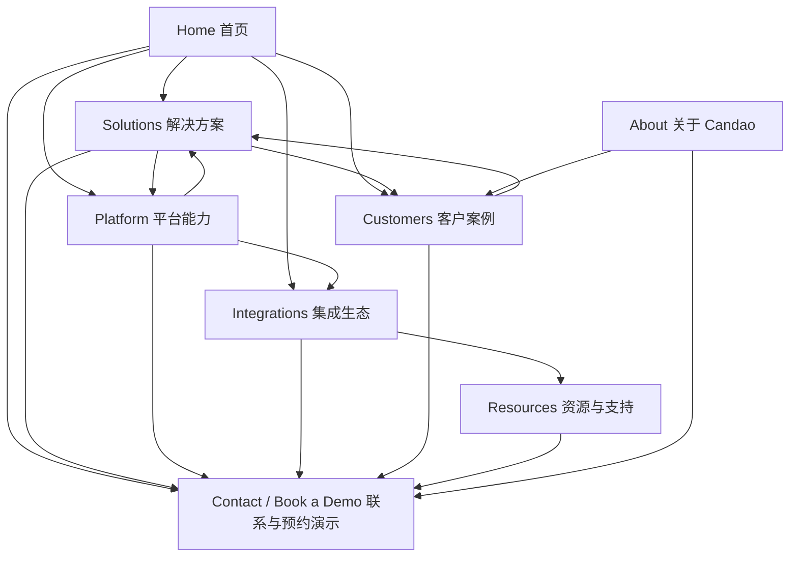

# Website Information Architecture

任务：T04 网站信息架构 Agent  
项目：餐道国际官网重构  
输出语言：简体中文，页面英文名称、导航字段和组件名保留英文  
生成时间：2026-08-02  

## 1. 执行边界

本文件基于 T01 v1.1 输入资料、T02 v1.1《Website Strategy Analysis》、T03 v1.1《Candao International Website Strategy V1.0》生成，用于将已冻结的官网战略转化为国际官网信息架构和 T05 Sitemap 前置结构。

T04 不重新判断官网定位，不搬运 Excel 原始菜单，不生成最终官网 Copy。

### 1.1 已使用输入

| 输入 | 用途 |
| --- | --- |
| T01《Candao International Website Input Document》 | 原始菜单、产品体系、官网表达资产、首页素材池 |
| T02《Website Strategy Analysis》 | 用户与页面映射、Solutions / Products 分层、战略决策矩阵 |
| T03《Candao International Website Strategy V1.0》 | 冻结定位、导航策略、首页逻辑、执行护栏 |
| Agent-PD 生成的 IA Agent 规格 | 约束 T04 输出结构、边界和验收标准 |

### 1.2 T03 Review Gate

| 检查项 | T04 处理 |
| --- | --- |
| 定位冻结 | 继续使用“全球餐饮智能运营 SaaS 平台” |
| 英文定位冻结 | 继续使用 `Intelligent SaaS Platform for Global Restaurant Operations` |
| 首页逻辑冻结 | 首页承担品牌认知、用户问题、能力摘要、信任证明和 Demo 转化 |
| 导航方向冻结 | 以 Home、Solutions、Platform、Integrations、Customers、Resources、About、Contact / Demo 组织 |
| 产品关系冻结 | Solutions 讲场景，Platform 讲能力 |
| 转化路径冻结 | Book a Demo、Contact Sales、Partner With Us、Request Integration |
| 未确认内容处理 | 只做结构预留，不写成确定事实 |

## 2. 信息架构原则

### 2.1 结构原则

1. 首页不是产品目录页，而是品牌认知和转化入口。
2. `Solutions` 面向客户问题和业务场景。
3. `Platform` 面向产品能力和模块边界。
4. `Integrations` 独立成一级入口，承接采购可信和技术合作。
5. `Customers / Case Studies` 承接信任证明，首期可以弱展示或模板化。
6. `Contact / Book a Demo` 是全站转化闭环，不隐藏在 Resources 下。
7. 未确认资料不进入外显内容，只在 IA 中保留页面或模块位置。

### 2.2 导航命名建议

T03 使用 `Products / Platform` 表示产品能力层。T04 建议对外导航优先使用 `Platform`，原因是它更符合国际 SaaS 官网表达，也能避免官网变成内部产品清单。

内部映射：

| 内部说法 | 对外导航建议 | 说明 |
| --- | --- | --- |
| Products / Platform | Platform | 表达 Candao 的统一能力平台 |
| OMS / COMS | Order Management | 放入 Platform 能力页，不作为主导航 |
| DMS / Delivery Aggregator | Delivery Management | 放入 Platform 能力页和 Delivery Operations 场景页 |
| QR Code Ordering / Order Website | Digital Ordering | 放入 Solutions 与 Platform 对应模块 |
| Data Asset | Data Intelligence | 放入 Platform 能力页 |

## 3. 推荐一级导航

| 一级导航 | 中文说明 | 页面角色 | Phase | 主 CTA |
| --- | --- | --- | --- | --- |
| Home | 首页 | 品牌认知、问题共鸣、能力摘要、信任入口、转化 | Phase 1 | Book a Demo |
| Solutions | 解决方案 | 按经营场景解释 Candao 如何解决客户问题 | Phase 1 | Talk to Sales |
| Platform | 平台能力 | 说明 Candao 平台由哪些能力组成 | Phase 1 | Book a Demo |
| Integrations | 集成生态 | 展示连接能力、技术可信和合作入口 | Phase 1 | Request Integration |
| Customers | 客户案例 | 承接案例、行业证明和采购信任 | Phase 1 弱展示，Phase 2 强化 | Contact Sales |
| Resources | 资源与支持 | FAQ、Support、Guides、Press 等辅助内容 | Phase 1 低承诺 | Contact Support |
| About | 关于 Candao | 公司可信度、服务能力、里程碑和主体说明 | Phase 1 | Contact Sales |
| Contact / Book a Demo | 联系与预约演示 | Demo、销售、合作伙伴、支持咨询分流 | Phase 1 | Submit Enquiry |

## 4. 网站结构总览

```text
Home

Solutions
  - Restaurant Chains
  - Multi-store Operations
  - Delivery Operations
  - Digital Ordering
  - Data-driven Operations
  - Retail Operations（Phase 2 / optional）

Platform
  - Platform Overview
  - Order Management
  - Menu and Store Management
  - Delivery Management
  - First-party Ordering
  - Data Intelligence

Integrations
  - Integrations Overview
  - Delivery Platforms
  - POS Integrations
  - Payment Gateways
  - CRM and Loyalty
  - Third-party Logistics
  - API Connectivity
  - Request Integration

Customers
  - Case Studies Overview
  - Customer Story Template
  - Restaurant Group Cases（授权后启用）
  - Delivery Operations Cases（授权后启用）

Resources
  - FAQ
  - Support
  - Guides（Phase 2）
  - Press（Phase 2）

About
  - About Us
  - Milestones
  - Security and Service Capability
  - Careers（Phase 2）

Contact / Book a Demo
  - Book a Demo
  - Contact Sales
  - Partner Enquiry
  - Support Enquiry

Footer
  - Privacy Policy
  - Terms of Use
  - Cookie Policy
  - Data Processing Addendum（DPA，占位）
```

## 5. 一级导航与二级页面定义

### 5.1 Home

| 字段 | 内容 |
| --- | --- |
| 服务对象 | 所有访客，重点是海外连锁餐饮集团、餐饮经营者、采购与管理层 |
| 页面目的 | 在第一屏建立 Candao 的国际 SaaS 定位，并引导用户进入 Solutions、Platform、Integrations 或 Demo |
| 核心内容 | Hero、Trust Bar、Problem Switcher、Capability Overview、Solutions Preview、Integrations Snapshot、Case Highlight、Final CTA |
| 页面关系 | 向 Solutions 分发业务场景流量，向 Platform 分发产品理解流量，向 Integrations 分发技术可信流量，向 Contact / Book a Demo 分发转化流量 |
| Phase | Phase 1 |

首页 Section 顺序：

1. `Hero`：定位、核心经营问题、主 CTA、真实餐饮运营场景 + SaaS UI 动效。
2. `Trust Bar`：客户、认证、服务能力或规模证明占位，未确认数据不外显。
3. `Problem Switcher`：多平台订单、菜单重复维护、配送异常、数据割裂。
4. `Capability Overview`：订单、菜单、配送、数据、集成五类能力入口。
5. `Solutions Preview`：连锁餐饮、多门店运营、自营点餐、配送管理等场景入口。
6. `Integrations Snapshot`：外卖平台、POS、支付、CRM、配送、API 分类。
7. `Case Highlight`：客户案例模板或授权后案例入口。
8. `Final CTA`：Book a Demo / Contact Sales。

### 5.2 Solutions

| 字段 | 内容 |
| --- | --- |
| 服务对象 | 海外连锁餐饮集团、餐饮经营者、营运负责人、区域经理 |
| 页面目的 | 按客户经营场景解释 Candao 的价值，帮助用户从“我遇到的问题”进入对应解决路径 |
| 核心内容 | 场景入口、用户问题、解决方式、关联 Platform 能力、证明材料占位、CTA |
| 页面关系 | 从 Home 承接问题流量，向 Platform 解释能力细节，向 Customers 建立证明，向 Contact / Book a Demo 转化 |
| Phase | Phase 1 |

二级页面：

| 页面 | 英文名称 | 服务对象 | 页面目的 | 核心内容 | Phase |
| --- | --- | --- | --- | --- | --- |
| 连锁餐饮解决方案 | Restaurant Chains | 连锁品牌总部、区域管理层 | 说明多品牌、多门店、多渠道运营如何被统一管理 | 总部运营问题、跨门店订单和菜单管理、数据可视、案例占位、Demo CTA | Phase 1 |
| 多门店运营 | Multi-store Operations | 营运负责人、区域经理 | 解决菜单、门店、库存、异常和数据分散问题 | 门店信息同步、菜单维护、异常监控、总部视图、相关 Platform 能力 | Phase 1 |
| 配送运营 | Delivery Operations | 外卖运营、配送负责人 | 说明自有配送与第三方配送如何协同 | 聚合配送、自有骑手管理、智能派单、配送追踪、异常处理 | Phase 1 |
| 数字点餐 | Digital Ordering | 品牌运营、门店管理者 | 说明自有点餐入口、二维码点餐和会员营销如何承接增长 | QR Code Ordering、自营外卖、会员与营销、支付与订单流转 | Phase 1 |
| 数据化运营 | Data-driven Operations | 总部管理层、财务、运营分析团队 | 说明订单、渠道、门店、配送和财务数据如何形成经营视图 | Operations Dashboard、报表、财务对账、跨渠道分析 | Phase 1 |
| 零售运营 | Retail Operations | 零售或餐饮零售混合业态 | 作为可扩展方向，是否进入主站取决于国际官网目标市场 | 零售场景、POS 对接、线上订单、库存与门店管理 | Phase 2 / optional |

### 5.3 Platform

| 字段 | 内容 |
| --- | --- |
| 服务对象 | 运营团队、技术评估团队、采购与管理层 |
| 页面目的 | 解释 Candao 平台由哪些能力组成，以及这些能力如何支撑 Solutions 中的业务场景 |
| 核心内容 | 平台能力总览、产品能力分组、典型流程、UI 展示方向、相关集成、CTA |
| 页面关系 | 从 Home 和 Solutions 承接产品理解需求，向 Integrations 延展连接能力，向 Contact / Book a Demo 转化 |
| Phase | Phase 1 |

二级页面：

| 页面 | 英文名称 | 服务对象 | 页面目的 | 核心内容 | Phase |
| --- | --- | --- | --- | --- | --- |
| 平台总览 | Platform Overview | 所有需要理解产品能力的访客 | 建立 Candao 是统一运营平台而非单点工具的认知 | 平台能力地图、业务流程、能力与场景映射、CTA | Phase 1 |
| 订单管理 | Order Management | 门店运营、总部运营、技术评估 | 说明多渠道订单如何集中处理和监控 | Omnichannel Order Management、订单状态、异常监控、POS 连接 | Phase 1 |
| 菜单与门店管理 | Menu and Store Management | 营运团队、菜单管理团队 | 说明菜单、门店信息和库存如何统一维护 | Multi-platform Menu Synchronization、Store Operations、库存与状态同步 | Phase 1 |
| 配送管理 | Delivery Management | 外卖运营、配送团队 | 说明聚合配送和自有骑手管理如何配合 | Aggregated Delivery、Smart Dispatch、Rider App、Real-time Delivery Tracking | Phase 1 |
| 自有点餐 | First-party Ordering | 品牌运营、增长团队 | 说明品牌自有点餐、扫码点餐和会员营销能力 | QR Code Ordering、Branded Online Ordering、Membership and Marketing | Phase 1 |
| 数据智能 | Data Intelligence | 管理层、财务、运营分析团队 | 说明经营数据、财务对账和报表如何支撑决策 | Operations Dashboard、Cross-channel Data Analytics、Financial Reconciliation、Custom Reports | Phase 1 |

### 5.4 Integrations

| 字段 | 内容 |
| --- | --- |
| 服务对象 | 企业技术团队、技术合作伙伴、采购评估人员 |
| 页面目的 | 证明 Candao 能连接客户现有餐饮技术生态，并为合作伙伴提供咨询入口 |
| 核心内容 | 集成类别、连接场景、数据流说明、状态标签预留、Request Integration CTA |
| 页面关系 | 从 Home、Platform 和 Partner 路径承接技术可信需求，向 Contact / Request Integration 转化 |
| Phase | Phase 1 |

二级页面：

| 页面 | 英文名称 | 服务对象 | 页面目的 | 核心内容 | Phase |
| --- | --- | --- | --- | --- | --- |
| 集成总览 | Integrations Overview | 企业客户、技术伙伴 | 展示 Candao 可连接的系统类别与合作方式 | Delivery Platforms、POS、Payment、CRM、Third-party Logistics、API 分类 | Phase 1 |
| 外卖平台集成 | Delivery Platforms | 餐饮企业、外卖运营团队 | 说明多平台订单接入和菜单同步的结构 | 平台类别、订单流、菜单同步、状态标签占位 | Phase 1 |
| POS 集成 | POS Integrations | 技术评估、门店系统团队 | 说明 POS 与订单、库存、财务数据如何连接 | POS 对接场景、订单/库存/财务数据流、实施咨询入口 | Phase 1 |
| 支付网关 | Payment Gateways | 技术团队、财务团队 | 说明支付与订单、对账流程的连接位置 | 支付类别、订单支付状态、财务对账入口 | Phase 1 |
| CRM 与会员 | CRM and Loyalty | 品牌运营、会员团队 | 说明会员、营销和客户数据如何与点餐场景连接 | CRM / Loyalty 分类、自有点餐、会员权益、营销活动 | Phase 1 |
| 第三方物流 | Third-party Logistics | 配送负责人、技术伙伴 | 说明第三方配送资源如何接入配送调度 | 3PL 分类、Dispatch、费用与交易记录、状态标签占位 | Phase 1 |
| API 连接 | API Connectivity | 技术伙伴、企业技术团队 | 作为 API 能力预留入口，公开深度取决于业务确认 | API 能力概述、合作流程、数据边界占位 | Phase 2 |
| 请求集成 | Request Integration | 技术合作伙伴、企业客户 | 收集集成咨询和合作需求 | 表单分流、系统类别、合作类型、联系信息 | Phase 1 |

### 5.5 Customers

| 字段 | 内容 |
| --- | --- |
| 服务对象 | 采购与管理层、连锁餐饮集团、经营者 |
| 页面目的 | 通过客户案例和行业证明建立采购信任 |
| 核心内容 | 案例分类、行业场景、结果指标占位、客户故事模板、CTA |
| 页面关系 | 从 Home、Solutions 和 Platform 承接信任需求，向 Contact / Book a Demo 转化 |
| Phase | Phase 1 弱展示，Phase 2 强化 |

二级页面：

| 页面 | 英文名称 | 服务对象 | 页面目的 | 核心内容 | Phase |
| --- | --- | --- | --- | --- | --- |
| 案例总览 | Case Studies Overview | 采购与管理层 | 建立 Candao 有真实餐饮交付经验的认知 | 案例类别、行业标签、结果结构占位、CTA | Phase 1 |
| 客户故事模板 | Customer Story Template | 内容团队、设计团队 | 为授权案例提供统一页面结构 | 背景、挑战、解决方式、使用能力、结果、CTA | Phase 1 |
| 连锁集团案例 | Restaurant Group Cases | 连锁餐饮集团 | 授权后展示大型集团或香港客户案例 | 多门店、多品牌、多渠道运营场景 | Phase 2 |
| 配送运营案例 | Delivery Operations Cases | 外卖与配送负责人 | 授权后展示配送管理、DMS 或聚合配送案例 | 配送挑战、调度方案、履约改善结果 | Phase 2 |

处理规则：

- 未确认客户名称、Logo、数据和推荐语不得进入正式页面内容。
- Phase 1 可以先设计案例区域和模板，不强行填充具体客户结果。

### 5.6 Resources

| 字段 | 内容 |
| --- | --- |
| 服务对象 | 采购评估人员、实施与运营团队、现有客户、内容访客 |
| 页面目的 | 承接常见问题、支持和辅助决策内容，第一阶段保持低承诺 |
| 核心内容 | FAQ、Support、Guides、Press、基础资源模板 |
| 页面关系 | 从所有核心页面的疑虑点进入 Resources，再引导 Contact、Support 或 Demo |
| Phase | Phase 1 低承诺，Phase 2 扩展 |

二级页面：

| 页面 | 英文名称 | 服务对象 | 页面目的 | 核心内容 | Phase |
| --- | --- | --- | --- | --- | --- |
| 常见问题 | FAQ | 采购、运营、技术评估 | 降低采购、实施、集成和服务疑虑 | 产品范围、实施流程、集成、安全、支持、Demo 问题 | Phase 1 |
| 支持 | Support | 现有客户、实施团队 | 提供支持入口和服务说明 | Support Enquiry、服务时间占位、问题分类、联系入口 | Phase 1 |
| 指南 | Guides | 内容访客、潜在客户 | 用于后续内容运营和市场教育 | 餐饮运营指南、集成指南、配送管理指南 | Phase 2 |
| 新闻 | Press | 媒体、合作伙伴、招聘访客 | 承接新闻和公司动态，但不作为第一阶段重点 | Press release、媒体联系、品牌资料 | Phase 2 |

### 5.7 About

| 字段 | 内容 |
| --- | --- |
| 服务对象 | 采购与管理层、合作伙伴、招聘访客 |
| 页面目的 | 建立公司可信度、服务能力和国际市场信任 |
| 核心内容 | 公司介绍、服务经验、办公与服务网络占位、安全与服务能力、里程碑、CTA |
| 页面关系 | 从 Home、Customers、Integrations 和 Footer 承接信任需求，向 Contact / Demo 转化 |
| Phase | Phase 1 |

二级页面：

| 页面 | 英文名称 | 服务对象 | 页面目的 | 核心内容 | Phase |
| --- | --- | --- | --- | --- | --- |
| 关于我们 | About Us | 采购、管理层、合作伙伴 | 说明 Candao 的公司背景和餐饮 SaaS 经验 | 公司介绍、服务范围、团队能力、办公地点占位 | Phase 1 |
| 发展里程碑 | Milestones | 采购、合作伙伴、招聘访客 | 建立长期经营与交付能力的时间线 | 成立年份、关键发展节点、区域拓展占位 | Phase 2 |
| 安全与服务能力 | Security and Service Capability | 采购、技术评估、合规评估 | 承接安全认证、服务管理和可靠性疑虑 | ISO 认证占位、服务流程、SLA 占位、数据安全说明 | Phase 1 结构预留 |
| 招聘 | Careers | 招聘访客 | 作为后续公司品牌延展 | 职位入口、团队介绍、联系方式 | Phase 2 |

### 5.8 Contact / Book a Demo

| 字段 | 内容 |
| --- | --- |
| 服务对象 | 潜在客户、采购人员、技术合作伙伴、现有客户 |
| 页面目的 | 将不同咨询意图分流到 Demo、销售、合作伙伴和支持路径 |
| 核心内容 | 表单分流、咨询类型、公司信息、联系方式、响应说明占位、隐私提示 |
| 页面关系 | 承接全站 CTA，是 Home、Solutions、Platform、Integrations、Customers 的统一转化终点 |
| Phase | Phase 1 |

二级入口：

| 入口 | 英文名称 | 服务对象 | 页面目的 | 核心内容 | Phase |
| --- | --- | --- | --- | --- | --- |
| 预约演示 | Book a Demo | 潜在客户、采购人员 | 收集 Demo 线索 | 公司、地区、门店规模占位、需求类型、联系方式 | Phase 1 |
| 联系销售 | Contact Sales | 企业客户、管理层 | 承接复杂采购和报价咨询 | 销售咨询表单、市场区域、产品兴趣、联系信息 | Phase 1 |
| 合作伙伴咨询 | Partner Enquiry | POS、支付、配送、CRM 等伙伴 | 承接合作与生态接入需求 | 合作类型、系统类别、合作地区、联系信息 | Phase 1 |
| 支持咨询 | Support Enquiry | 现有客户、实施团队 | 分流支持问题 | 问题类别、客户信息、联系方式、Support 入口 | Phase 1 |

## 6. 页面关系

### 6.1 全站关系图



### 6.2 关系说明

| 来源页面 | 目标页面 | 关系目的 |
| --- | --- | --- |
| Home | Solutions | 用户先从业务问题进入场景方案 |
| Home | Platform | 用户直接了解平台能力 |
| Home | Integrations | 技术或采购用户验证是否能接入现有生态 |
| Home | Customers | 需要信任证明的用户查看案例 |
| Solutions | Platform | 场景方案需要产品能力支撑 |
| Platform | Integrations | 产品能力需要连接能力证明 |
| Integrations | Contact / Request Integration | 技术合作和集成咨询转化 |
| Customers | Contact / Book a Demo | 案例信任转化为销售线索 |
| Resources | Contact / Support Enquiry | FAQ 或支持问题进入分流表单 |
| About | Contact / Contact Sales | 公司可信建立后进入咨询 |

## 7. 用户路径

### 7.1 标准访客路径

```text
进入官网
→ 理解品牌
→ 了解产品
→ 建立信任
→ 提交咨询
```

对应页面：

| 阶段 | 页面 | 用户任务 | 页面承接 |
| --- | --- | --- | --- |
| 进入官网 | Home | 快速判断 Candao 是谁 | Hero、Trust Bar、Problem Switcher |
| 理解品牌 | Home、About | 判断 Candao 是否懂餐饮运营 | 品牌定位、公司背景、服务能力 |
| 了解产品 | Solutions、Platform | 判断是否解决自己的问题 | 场景方案、平台能力、产品流程 |
| 建立信任 | Integrations、Customers、FAQ、Security and Service Capability | 判断是否可信、可集成、可采购 | 集成类别、案例结构、安全与服务占位、常见问题 |
| 提交咨询 | Contact / Book a Demo | 发起 Demo、销售或合作咨询 | 表单分流、CTA、联系入口 |

### 7.2 海外连锁餐饮集团路径

```text
Home
→ Solutions / Restaurant Chains
→ Platform / Order Management 或 Data Intelligence
→ Integrations
→ Customers
→ Book a Demo
```

路径目标：

- 先确认 Candao 能处理多门店、多渠道和多系统复杂度；
- 再查看订单、菜单、数据和集成能力；
- 最后通过案例和 Demo 建立采购下一步。

### 7.3 餐饮经营者路径

```text
Home
→ Solutions / Multi-store Operations 或 Digital Ordering
→ Platform / Menu and Store Management
→ FAQ
→ Book a Demo
```

路径目标：

- 先看到漏单、菜单重复维护、配送异常等日常问题；
- 再理解 Candao 如何减少门店重复操作；
- 通过 FAQ 降低实施疑虑后预约演示。

### 7.4 技术合作伙伴路径

```text
Home
→ Integrations
→ API Connectivity 或 Request Integration
→ About / Security and Service Capability
→ Partner Enquiry
```

路径目标：

- 快速判断 Candao 是否具备生态连接能力；
- 查看集成类别、API 预留和合作方式；
- 通过 Partner Enquiry 提交合作意向。

### 7.5 采购与管理层路径

```text
Home
→ About
→ Customers
→ Platform Overview
→ Contact Sales
```

路径目标：

- 先确认公司可信度；
- 再查看客户案例和平台能力；
- 最后进入销售咨询或 Demo。

## 8. Phase 划分

### 8.1 Phase 1 页面

Phase 1 聚焦品牌认知、产品理解、集成可信和转化闭环。

| 页面 | 英文名称 | 类型 | 优先级 | 说明 |
| --- | --- | --- | --- | --- |
| 首页 | Home | 一级页面 | P0 | 官网第一入口 |
| 解决方案 | Solutions | 一级页面 | P0 | 场景入口 |
| 连锁餐饮解决方案 | Restaurant Chains | 二级页面 | P0 | 连锁客户核心场景 |
| 多门店运营 | Multi-store Operations | 二级页面 | P0 | 总部与门店运营场景 |
| 配送运营 | Delivery Operations | 二级页面 | P0 | 配送管理核心场景 |
| 数字点餐 | Digital Ordering | 二级页面 | P1 | 自有点餐和会员增长 |
| 数据化运营 | Data-driven Operations | 二级页面 | P1 | 数据与财务对账场景 |
| 平台能力 | Platform | 一级页面 | P0 | 产品能力入口 |
| 平台总览 | Platform Overview | 二级页面 | P0 | 能力地图 |
| 订单管理 | Order Management | 二级页面 | P0 | 核心能力 |
| 菜单与门店管理 | Menu and Store Management | 二级页面 | P0 | 核心能力 |
| 配送管理 | Delivery Management | 二级页面 | P0 | 核心能力 |
| 自有点餐 | First-party Ordering | 二级页面 | P1 | 增长能力 |
| 数据智能 | Data Intelligence | 二级页面 | P1 | 决策能力 |
| 集成生态 | Integrations | 一级页面 | P0 | 技术可信入口 |
| 外卖平台集成 | Delivery Platforms | 二级页面 | P0 | 核心集成类别 |
| POS 集成 | POS Integrations | 二级页面 | P0 | 核心集成类别 |
| 支付网关 | Payment Gateways | 二级页面 | P1 | 采购和财务关注 |
| CRM 与会员 | CRM and Loyalty | 二级页面 | P1 | 品牌增长关注 |
| 第三方物流 | Third-party Logistics | 二级页面 | P1 | 配送生态 |
| 请求集成 | Request Integration | 表单入口 | P0 | 技术合作转化 |
| 客户案例 | Customers / Case Studies | 一级页面 | P1 | 信任入口，先弱展示 |
| 案例总览 | Case Studies Overview | 二级页面 | P1 | 案例结构与模板 |
| 客户故事模板 | Customer Story Template | 模板 | P1 | 等待授权内容填充 |
| FAQ | FAQ | 支持页面 | P1 | 降低疑虑 |
| Support | Support | 支持页面 | P1 | 支持入口 |
| 关于我们 | About Us | 公司页面 | P1 | 公司可信 |
| 安全与服务能力 | Security and Service Capability | 信任页面 | P1 | 结构预留，内容待确认 |
| 联系与预约演示 | Contact / Book a Demo | 转化页面 | P0 | 全站转化闭环 |
| 隐私政策 | Privacy Policy | 页脚法律页 | P0 | 发布前必须补齐 |
| 使用条款 | Terms of Use | 页脚法律页 | P0 | 发布前必须补齐 |
| Cookie 政策 | Cookie Policy | 页脚法律页 | P1 | 取决于站点追踪方案 |

### 8.2 Phase 2 页面

| 页面 | 英文名称 | 类型 | 延后原因 |
| --- | --- | --- | --- |
| 零售运营 | Retail Operations | Solution | 国际官网是否保留 Retail 需确认 |
| API 连接 | API Connectivity | Integration | API 公开程度未确认 |
| 连锁集团案例 | Restaurant Group Cases | Case Studies | 需要客户授权 |
| 配送运营案例 | Delivery Operations Cases | Case Studies | 需要客户授权和结果口径 |
| 指南 | Guides | Resources | 内容运营责任未确认 |
| 新闻 | Press | Resources | 不建议第一阶段做成高频内容中心 |
| 发展里程碑 | Milestones | About | 可从 About Us 模块开始，后续独立 |
| 招聘 | Careers | About | 非第一阶段转化核心 |
| 国家/地区落地页 | Market Pages | Market | 第一阶段市场优先级未确认 |
| 数据处理附录 | Data Processing Addendum | Legal | 需法律和数据合规确认 |

## 9. T05 Sitemap 输入

以下表格可作为 T05 的直接输入。T05 需要进一步输出正式 Sitemap，并明确简体中文页面名 + 英文页面名称。

| 层级 | 页面 | 英文名称 | 建议路径 | Phase | 页面目标 |
| --- | --- | --- | --- | --- | --- |
| 一级 | 首页 | Home | `/` | Phase 1 | 建立品牌认知并推动 Demo |
| 一级 | 解决方案 | Solutions | `/solutions` | Phase 1 | 按客户场景解释价值 |
| 二级 | 连锁餐饮解决方案 | Restaurant Chains | `/solutions/restaurant-chains` | Phase 1 | 说明连锁餐饮多门店运营价值 |
| 二级 | 多门店运营 | Multi-store Operations | `/solutions/multi-store-operations` | Phase 1 | 说明总部和门店统一管理 |
| 二级 | 配送运营 | Delivery Operations | `/solutions/delivery-operations` | Phase 1 | 说明配送调度和履约管理 |
| 二级 | 数字点餐 | Digital Ordering | `/solutions/digital-ordering` | Phase 1 | 说明自有点餐和会员增长 |
| 二级 | 数据化运营 | Data-driven Operations | `/solutions/data-driven-operations` | Phase 1 | 说明数据分析和财务对账价值 |
| 二级 | 零售运营 | Retail Operations | `/solutions/retail-operations` | Phase 2 | 作为餐饮零售扩展方向 |
| 一级 | 平台能力 | Platform | `/platform` | Phase 1 | 解释 Candao 平台能力结构 |
| 二级 | 平台总览 | Platform Overview | `/platform/overview` | Phase 1 | 展示能力地图和业务流程 |
| 二级 | 订单管理 | Order Management | `/platform/order-management` | Phase 1 | 展示多渠道订单管理能力 |
| 二级 | 菜单与门店管理 | Menu and Store Management | `/platform/menu-store-management` | Phase 1 | 展示菜单、门店和库存同步能力 |
| 二级 | 配送管理 | Delivery Management | `/platform/delivery-management` | Phase 1 | 展示聚合配送和自有骑手管理 |
| 二级 | 自有点餐 | First-party Ordering | `/platform/first-party-ordering` | Phase 1 | 展示自营点餐和会员营销能力 |
| 二级 | 数据智能 | Data Intelligence | `/platform/data-intelligence` | Phase 1 | 展示经营看板、报表和财务对账 |
| 一级 | 集成生态 | Integrations | `/integrations` | Phase 1 | 展示生态连接能力 |
| 二级 | 外卖平台集成 | Delivery Platforms | `/integrations/delivery-platforms` | Phase 1 | 展示外卖平台集成类别 |
| 二级 | POS 集成 | POS Integrations | `/integrations/pos` | Phase 1 | 展示 POS 连接能力 |
| 二级 | 支付网关 | Payment Gateways | `/integrations/payment-gateways` | Phase 1 | 展示支付和对账连接 |
| 二级 | CRM 与会员 | CRM and Loyalty | `/integrations/crm-loyalty` | Phase 1 | 展示会员和营销系统连接 |
| 二级 | 第三方物流 | Third-party Logistics | `/integrations/third-party-logistics` | Phase 1 | 展示第三方配送连接 |
| 二级 | API 连接 | API Connectivity | `/integrations/api` | Phase 2 | 作为 API 能力公开入口 |
| 二级 | 请求集成 | Request Integration | `/integrations/request` | Phase 1 | 承接集成咨询 |
| 一级 | 客户案例 | Customers / Case Studies | `/customers` | Phase 1 | 建立客户信任 |
| 二级 | 案例总览 | Case Studies Overview | `/customers/case-studies` | Phase 1 | 展示案例分类和模板 |
| 二级 | 客户故事模板 | Customer Story Template | `/customers/story-template` | Phase 1 | 为授权案例预留结构 |
| 二级 | 连锁集团案例 | Restaurant Group Cases | `/customers/restaurant-groups` | Phase 2 | 授权后展示连锁集团案例 |
| 二级 | 配送运营案例 | Delivery Operations Cases | `/customers/delivery-operations` | Phase 2 | 授权后展示配送案例 |
| 一级 | 资源与支持 | Resources | `/resources` | Phase 1 | 承接 FAQ、Support 和低承诺内容 |
| 二级 | 常见问题 | FAQ | `/resources/faq` | Phase 1 | 降低采购和实施疑虑 |
| 二级 | 支持 | Support | `/resources/support` | Phase 1 | 提供支持入口 |
| 二级 | 指南 | Guides | `/resources/guides` | Phase 2 | 后续内容运营 |
| 二级 | 新闻 | Press | `/resources/press` | Phase 2 | 后续媒体和动态 |
| 一级 | 关于 Candao | About | `/about` | Phase 1 | 建立公司可信度 |
| 二级 | 关于我们 | About Us | `/about/company` | Phase 1 | 说明公司背景和服务能力 |
| 二级 | 发展里程碑 | Milestones | `/about/milestones` | Phase 2 | 展示发展历程 |
| 二级 | 安全与服务能力 | Security and Service Capability | `/about/security-service` | Phase 1 | 承接安全和服务管理疑虑 |
| 二级 | 招聘 | Careers | `/about/careers` | Phase 2 | 招聘入口 |
| 一级 | 联系与预约演示 | Contact / Book a Demo | `/contact` | Phase 1 | 承接全站咨询 |
| 二级 | 预约演示 | Book a Demo | `/book-a-demo` | Phase 1 | Demo 线索收集 |
| 二级 | 联系销售 | Contact Sales | `/contact/sales` | Phase 1 | 销售咨询 |
| 二级 | 合作伙伴咨询 | Partner Enquiry | `/contact/partners` | Phase 1 | 合作伙伴咨询 |
| 二级 | 支持咨询 | Support Enquiry | `/contact/support` | Phase 1 | 支持问题分流 |
| 页脚 | 隐私政策 | Privacy Policy | `/privacy-policy` | Phase 1 | 法律与隐私说明 |
| 页脚 | 使用条款 | Terms of Use | `/terms-of-use` | Phase 1 | 法律条款 |
| 页脚 | Cookie 政策 | Cookie Policy | `/cookie-policy` | Phase 1 | Cookie 和追踪说明 |
| 页脚 | 数据处理附录 | Data Processing Addendum | `/data-processing-addendum` | Phase 2 | 数据处理与合规补充 |

## 10. 全局导航与转化规则

### 10.1 Header

推荐 Header 结构：

```text
Logo
Home
Solutions
Platform
Integrations
Customers
Resources
About
Book a Demo
```

执行说明：

- `Book a Demo` 应作为主按钮。
- `Contact Sales` 可作为 Contact 页面内的分流入口，或作为次级 CTA。
- `Resources` 不应在第一阶段展开过多内容，避免形成空内容中心。
- 移动端 Header 应优先展示核心路径：Solutions、Platform、Integrations、Book a Demo。

### 10.2 Footer

Footer 应承接完整页面、法律页面和辅助入口。

建议 Footer 分组：

| 分组 | 链接 |
| --- | --- |
| Solutions | Restaurant Chains、Multi-store Operations、Delivery Operations、Digital Ordering、Data-driven Operations |
| Platform | Order Management、Menu and Store Management、Delivery Management、First-party Ordering、Data Intelligence |
| Integrations | Delivery Platforms、POS、Payment Gateways、CRM and Loyalty、Third-party Logistics、Request Integration |
| Company | About Us、Customers、Security and Service Capability、Contact |
| Resources | FAQ、Support、Guides、Press |
| Legal | Privacy Policy、Terms of Use、Cookie Policy、Data Processing Addendum |

### 10.3 CTA 分流

| CTA | 出现场景 | 目标 |
| --- | --- | --- |
| Book a Demo | Home、Solutions、Platform、Customers、Final CTA | 主销售线索转化 |
| Contact Sales | Pricing 疑虑、企业采购、About、Customers | 复杂销售咨询 |
| Request Integration | Integrations、Platform、Partner 路径 | 集成需求收集 |
| Partner Enquiry | Integrations、Contact、Footer | 合作伙伴获取 |
| Support Enquiry | Support、FAQ、Footer | 支持问题分流 |

## 11. 待确认内容的结构预留

| 内容 | IA 处理 | 影响页面 |
| --- | --- | --- |
| 客户 Logo | 预留客户 Logo / Case Highlight 模块，不填具体 Logo | Home、Customers |
| 客户案例 | 先设计 Case Studies Overview 和 Customer Story Template | Customers、Solutions |
| 规模数字 | Trust Bar 预留指标位置，不写具体数字 | Home、About |
| ISO 认证 | Security and Service Capability 页面预留认证区域 | About、Footer |
| 集成平台状态 | Integrations 使用类别和状态标签结构，不写确定合作状态 | Integrations |
| Pricing | 不设主导航 Pricing，以 Contact Sales 承接 | Header、Contact |
| API 公开程度 | API Connectivity 设为 Phase 2 | Integrations |
| 法律条款 | 页脚必须保留 Privacy、Terms、Cookie、DPA 结构 | Footer |

## 12. T04 v1.1 增补：后续执行优先级

本节根据 T04 审查意见补充，用于提升 T06 Copy、T08 UX 和 T10 视觉设计的执行稳定性。本节不改变 T04 已确定的信息架构，只补充页面商业目标、内容优先级、产品页面结构规范和页面视觉复杂度。

### 12.1 页面商业目标

| 页面 | 商业目标 | 主 CTA | 辅助 CTA | 后续影响 |
| --- | --- | --- | --- | --- |
| Home | 建立品牌认知并获取 Demo 线索 | Book a Demo | Explore Solutions / Explore Platform | T06 首页文案和 T08 首页 UX 必须围绕认知到转化组织 |
| Solutions | 证明 Candao 能解决具体餐饮运营问题 | Talk to Sales | Book a Demo / Explore Platform | Copy 应以业务场景开头，UX 应提供场景到能力的路径 |
| Platform | 建立产品理解和产品信任 | Book a Demo | View Integrations / Explore Solutions | 避免产品目录化，重点解释流程、界面和业务结果 |
| Integrations | 获取集成咨询和合作机会 | Request Integration | Partner Enquiry / Contact Sales | 需要清晰表达集成类别、状态预留和咨询路径 |
| Customers | 建立采购信任 | Contact Sales | Book a Demo | Phase 1 使用案例模板和授权案例，不强行填充未确认内容 |
| Resources | 降低采购、实施和支持疑虑 | Contact Support | Book a Demo | 第一阶段保持低承诺，优先 FAQ 和 Support |
| About | 建立公司可信度 | Contact Sales | Book a Demo | 重点承接公司背景、安全服务能力和签约疑虑 |
| Contact / Book a Demo | 完成线索收集和咨询分流 | Submit Enquiry | Contact Sales / Partner Enquiry / Support Enquiry | 必须支持不同用户意图的表单分流 |

### 12.2 页面内容优先级

后续 Copy、UX 和视觉设计应优先处理 P0 内容。P1 用于增强信任或理解，P2 用于辅助信息和后续扩展。

| 页面 | P0 内容 | P1 内容 | P2 内容 |
| --- | --- | --- | --- |
| Home | Hero、Problem Switcher、Capability Overview、Final CTA | Trust Bar、Solutions Preview、Integrations Snapshot、Case Highlight | Resources 入口、Footer |
| Solutions | 场景问题、解决路径、关联 Platform 能力、CTA | 证明材料占位、相关案例入口、FAQ | 延展资源、市场页入口 |
| Platform | Platform Overview、能力地图、关键流程、UI Demo、CTA | 关联 Solutions、Integrations、证明材料占位 | 具体功能细节、技术资料入口 |
| Integrations | 集成类别、系统连接场景、Request Integration CTA | 状态标签预留、合作方式、数据流说明 | API Connectivity、技术资源 |
| Customers | Case Studies Overview、Customer Story Template、Authorized Case 区域 | 行业标签、结果指标占位、相关 Solutions | Full Customer Stories |
| Resources | FAQ、Support、联系入口 | Guides 模板、Press 模板 | 长期内容运营栏目 |
| About | About Us、服务能力、安全与服务能力占位、Contact CTA | Milestones、办公与服务网络占位 | Careers、Press 入口 |
| Contact / Book a Demo | 表单分流、Book a Demo、Contact Sales、隐私提示 | Partner Enquiry、Support Enquiry、响应说明占位 | 地区办公室和补充联系方式 |

### 12.3 产品页面内容结构规范

`Platform` 及其二级页面不能写成产品目录或功能说明书。每个产品页面必须遵循以下结构：

```text
Business Problem
→ Solution
→ Product Capability
→ UI Demo
→ Business Outcome
→ CTA
```

页面执行规则：

| 层级 | 内容要求 | 示例方向 |
| --- | --- | --- |
| Business Problem | 先说明用户正在面对的经营问题 | 多渠道订单分散、菜单重复维护、高峰配送不可控、数据割裂 |
| Solution | 说明 Candao 如何组织解决路径 | 统一接单、同步菜单、调度配送、汇总数据、连接现有系统 |
| Product Capability | 再进入具体能力模块 | Order Management、Menu and Store Management、Delivery Management、Data Intelligence |
| UI Demo | 使用产品界面、流程动效或状态变化说明能力 | 订单流转、菜单同步、配送状态、经营看板 |
| Business Outcome | 回到业务结果 | 减少切换、降低错误、提升可视性、加强总部管控 |
| CTA | 引导下一步 | Book a Demo、Contact Sales、View Integrations |

各产品页重点：

| 页面 | 第一表达 | 不建议第一表达 |
| --- | --- | --- |
| Order Management | 多渠道订单集中处理和异常可见 | OMS / COMS 功能列表 |
| Menu and Store Management | 菜单、门店和库存信息统一维护 | 菜单字段或后台配置清单 |
| Delivery Management | 自有与第三方配送协同调度 | DMS / Aggregator 模块清单 |
| First-party Ordering | 品牌自有点餐和会员增长路径 | QR Code Ordering 单点功能 |
| Data Intelligence | 总部经营数据可视和对账决策 | 报表数量或看板截图堆叠 |

### 12.4 页面视觉复杂度等级

视觉复杂度用于指导 T10/T11 投入，不代表页面重要性唯一排序。高复杂度页面需要更多真实餐饮场景、产品 UI 动效和交互设计。

| 页面 | 视觉复杂度 | 设计重点 | 资源投入建议 |
| --- | --- | --- | --- |
| Home | ★★★★★ | 首屏品牌印象、运营场景、UI 动效、转化引导 | 最高优先级 |
| Platform Overview | ★★★★★ | 平台能力地图、操作流程、产品 UI 动效 | 最高优先级 |
| Solutions | ★★★★ | 场景化内容、问题到方案路径、行业感 | 高优先级 |
| Order Management / Delivery Management | ★★★★ | 关键流程、状态变化、UI Demo | 高优先级 |
| Integrations | ★★★★ | 集成类别、生态连接、状态标签、技术可信 | 高优先级 |
| Contact / Book a Demo | ★★★★ | 表单分流、信任提示、低摩擦转化 | 高优先级 |
| Customers | ★★★ | 案例模板、授权案例、行业标签 | 中优先级 |
| Data Intelligence | ★★★ | 数据看板、报表逻辑、经营视图 | 中优先级 |
| About | ★★ | 公司可信、服务能力、安全占位 | 基础设计 |
| Resources / FAQ / Support | ★★ | 信息清晰、可扫描、易查找 | 基础设计 |
| Legal 页面 | ★ | 可读性和合规完整性 | 模板化 |

### 12.5 Customers 页面策略补充

Customers 第一阶段不是“没有案例”，而是采用谨慎展示策略。

Phase 1 建议结构：

```text
Customer Overview
→ Story Template
→ Authorized Case
→ CTA
```

执行说明：

- 如果已有授权客户案例，则进入 `Authorized Case` 区域。
- 如果客户授权暂未完成，则保留案例模板、行业标签和结果结构，不填客户名称、Logo、数据或推荐语。
- Phase 1 的目标是让设计和内容结构先成立，同时避免合规和授权风险。

Phase 2 扩展：

- Full Customer Stories；
- Restaurant Group Cases；
- Delivery Operations Cases；
- 带行业、地区、产品能力和业务结果筛选的案例库。

## 13. 对后续任务的输入

### 13.1 对 T05 Sitemap 的输入

- 使用第 9 节作为 Sitemap 主输入。
- T05 应进一步清理页面层级、URL、Phase、页面目标和中英文页面名称。
- T05 不应重新判断导航策略。
- T05 必须补齐页面名称、URL、层级、页面目标、目标用户、核心内容、CTA、Phase 和状态。

### 13.2 对 T06/T07 Copy 的输入

- T06/T07 应按页面 IA 生成繁体中文 + 英文官网文案。
- 不得输出简体中文正式网页文案。
- Copy 应先写用户问题和业务结果，再写产品能力。
- 未确认数据、客户、认证、Logo、案例和集成状态不得写成正式陈述。
- T06/T07 必须继承第 12.1 节页面商业目标和第 12.3 节产品页面内容结构。

### 13.3 对 T08/T09 UX 的输入

- UX 应优先打磨 Home、Platform、Solutions、Integrations、Contact / Book a Demo。
- Products / Platform 页面必须遵守“场景问题 → 操作流程 → 产品界面 → 业务结果 → 下一步行动”。
- Contact 页面必须支持 Demo、Sales、Partner、Support 分流。
- UX 应继承第 12.2 节页面内容优先级，优先确保 P0 内容在首屏和核心路径中成立。

### 13.4 对 T10/T11 视觉的输入

- 视觉应优先服务 Home 和 Platform。
- 主视觉方向为真实餐饮运营场景 + SaaS UI 动效。
- 不使用纯科技抽象视觉作为主叙事。
- T10/T11 应继承第 12.4 节页面视觉复杂度等级分配设计资源。

## 14. T04 结论

T04 建议将 Candao 国际官网组织为：

```text
Home
→ Solutions
→ Platform
→ Integrations
→ Customers
→ Resources
→ About
→ Contact / Book a Demo
```

该结构满足 T03 冻结策略：

- 先让用户理解 Candao 是全球餐饮智能运营 SaaS 平台；
- 再通过 Solutions 进入业务场景；
- 通过 Platform 理解产品能力；
- 通过 Integrations 和 Customers 建立可信；
- 最后通过 Contact / Book a Demo 提交咨询。

T05 可以基于本文件直接生成正式 Sitemap。
