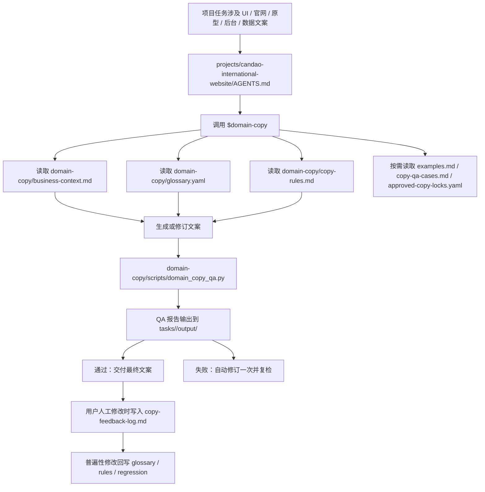

# T19 行业文案能力落地报告

日期：2026-08-15  
项目：餐道国际官网重构  
目标：把“文案行业感不足、业务表达不准确、内容过长、原型阶段擅自删减文案”从一次性人工纠偏升级为可复用、可质检、可锁定、可持续更新的行业文案能力。

## 1. 新增和修改的文件

### 项目内新增

- `projects/candao-international-website/domain-copy/business-context.md`
- `projects/candao-international-website/domain-copy/glossary.yaml`
- `projects/candao-international-website/domain-copy/copy-rules.md`
- `projects/candao-international-website/domain-copy/examples.md`
- `projects/candao-international-website/domain-copy/copy-qa-cases.md`
- `projects/candao-international-website/domain-copy/approved-copy-locks.yaml`
- `projects/candao-international-website/domain-copy/copy-feedback-log.md`
- `projects/candao-international-website/domain-copy/scripts/domain_copy_qa.py`
- `projects/candao-international-website/domain-copy/regression/qa-regression-input.json`
- `projects/candao-international-website/domain-copy/regression/qa-failure-demo-input.json`
- `projects/candao-international-website/AGENTS.md`
- `projects/candao-international-website/tasks/T19/task.md`
- `projects/candao-international-website/tasks/T19/output/qa-regression-result-2026-08-15.json`
- `projects/candao-international-website/tasks/T19/output/qa-failure-demo-result-2026-08-15.json`
- `projects/candao-international-website/tasks/T19/output/qa-failure-demo-autofix-2026-08-15.json`

### 项目内修改

- `projects/candao-international-website/RULES.md`

### 全局 Skill 新增

- `/Users/victorwong/.codex/skills/domain-copy/SKILL.md`
- `/Users/victorwong/.codex/skills/domain-copy/agents/openai.yaml`
- `/Users/victorwong/.codex/skills/domain-copy/references/workflow.md`
- `/Users/victorwong/.codex/skills/domain-copy/scripts/domain_copy_qa.py`

## 2. 文件之间的调用关系



## 3. 一次完整生成流程

1. 识别任务是否涉及 UI 文案、原型内容、页面说明、指标卡、后台页面、数据大屏、状态提示或产品页面说明。
2. 命中后调用 `$domain-copy`。
3. 读取 `business-context.md`，确认当前产品类型、目标用户、用户角色、业务流程、业务对象、状态异常、指标来源和项目范围。
4. 读取 `glossary.yaml`，确认标准术语、受保护术语、禁止替换项、不推荐表达、允许使用的指标、已确认状态和异常。
5. 读取 `copy-rules.md`，按组件类型生成内容：页面标题、说明、指标卡、表格字段、图表标题、按钮、表单、成功提示、错误提示、空状态、异常预警。
6. 为每条文案写清目标角色、页面任务、业务对象、状态、条件、数据口径、来源和下一步操作。
7. 使用 QA 输入模板形成 `items[]`。
8. 运行 `domain_copy_qa.py`。
9. 未通过时自动修改一次并复检；仍未通过则报告阻塞原因，不输出未经检查的最终文案。
10. 文案被审核通过后可写入 `approved-copy-locks.yaml` 并标记 `approved_and_locked`；原型阶段只允许调布局。

## 4. 自动质检示例

正向回归命令：

```bash
python3 projects/candao-international-website/domain-copy/scripts/domain_copy_qa.py \
  --context projects/candao-international-website/domain-copy \
  --input projects/candao-international-website/domain-copy/regression/qa-regression-input.json \
  --output projects/candao-international-website/tasks/T19/output/qa-regression-result-2026-08-15.json
```

结果：10 个典型页面任务全部通过。

失败拦截示例命中：

- 泛化表达：`帮助企业数字化转型`、`打造智慧生态`、`提升用户体验`
- 未确认声明：`24/7 SLA`
- 未定义指标：`99.99%`
- 锁定文案改写：`approved_and_locked 文案被改写`
- 原型可能删减：当前文本比来源文本短超过 25%

## 5. 修改回写示例

已在 `copy-feedback-log.md` 写入两类回写：

- PPT 数据准确且授权展示：作为项目事实，写入 `business-context.md` 与 `glossary.yaml` 的允许指标，不写成泛用行业规则。
- 文案行业感不足与原型擅自删减：作为普遍性流程问题，写入 `copy-rules.md`、`approved-copy-locks.yaml`、`copy-qa-cases.md` 和 `$domain-copy` Skill。

后续每次用户人工修改都按以下判断：

- 只影响某一页、某个产品事实：写入项目资料或任务输出。
- 影响多个页面、多个任务或多个 Agent：同步更新术语、规则或回归案例。
- 只是审美偏好但不改变业务：记录在反馈日志，暂不升级成永久规则。

## 6. 回归测试结果

已覆盖不少于 10 个典型页面任务：

| 测试项 | 覆盖内容 | 结果 |
| --- | --- | --- |
| 指标卡 | 品牌数量、来源、标准行业术语 | 通过 |
| 经营概览 | 多平台订单、OMS、渠道、门店、异常、CDBI | 通过 |
| 订单列表 | 字段完整性、订单与配送状态、下一步操作 | 通过 |
| 异常提醒 | 门店、外卖订单、超时条件、影响、处理动作 | 通过 |
| 表单说明 | Demo 分流、系统范围、产品演示范围 | 通过 |
| 操作确认 | 配送中订单、转派、状态更新、派单记录 | 通过 |
| 空状态 | 异常订单、接单超时、退款未处理、配送中断 | 通过 |
| 数据大屏 | 平台订单量、门店接单状态、今日时段、异常 | 通过 |
| 用户端进度提示 | 已接单、制作、取餐、配送中、配送超时 | 通过 |
| 管理后台页面 | AMS / Connector、POS、KDS、CRM、ERP、API、权限、异常处理 | 通过 |

Skill 验证：

- `SKILL.md`、`agents/openai.yaml`、`references/workflow.md`、`scripts/domain_copy_qa.py` 已创建。
- 使用临时 `PyYAML` 依赖运行 `quick_validate.py`，结果：`Skill is valid!`
- 项目 QA 脚本与 Skill QA 脚本均通过 `py_compile`。

## 7. 仍需人工确认的内容

- 哪些现有官网页面文案正式进入 `approved_and_locked`。
- 最终官网繁体中文与英文版本的逐页审核口径。
- 部分产品英文命名是否完全沿用 PPT / 旧官网，或需要营销化命名。
- 客户案例中可公开展示的数据、品牌名、截图和Logo授权边界。
- 原型或高保真阶段各模块的真实可用空间；如锁定文案溢出，需要由设计调整布局而非缩短文案。
